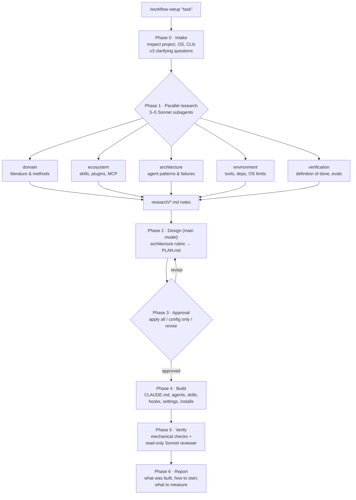

# workflow-setup

A Claude Code skill that designs and builds a Claude workflow for **your specific task**: one command researches the task on the web, picks a single-agent or multi-agent architecture, and, once you approve the plan, generates the project config (CLAUDE.md, subagents, skills, hooks, settings).

```
/workflow-setup "Build a weekly competitor-pricing report from 30 e-commerce sites"
```

## Why

Configuring Claude Code for a new kind of work usually goes one of two ways:

- **Too little.** The defaults are used with no definition of done, so the agent stops when it *thinks* it's finished, reviews its own work leniently, and repeats the same mistakes.
- **Too much.** A pile of persona agents, MCP servers "just in case", and a 500-line CLAUDE.md. It burns tokens and context and isn't measurably better.

Getting it right takes research: what the domain's best practices are, which skills, plugins and MCP servers already exist and can be trusted, what tooling the environment needs, how to verify the output, and whether multi-agent actually pays off for this task. Anthropic's own data shows multi-agent setups use about 15× the tokens of chat. That pays off for broad, parallel research and is a bad trade for tightly coupled work like most coding.

`workflow-setup` automates that research and applies one rule throughout: **build the workflow around a verifiable definition of done, not around the number of agents.** Every component it adds has to justify its cost.

## Pipeline



| Phase | Who | What happens | Output |
|---|---|---|---|
| 0. Intake | Main model | Reads the project (existing `CLAUDE.md`, `.claude/`, git, languages, OS, available CLIs) and asks only the questions that change the architecture | Environment profile |
| 1. Research | 3–5 Sonnet subagents in parallel | Each takes one brief and searches primary sources with URLs and dates | `.workflow-setup/<slug>/research/*.md` |
| 2. Design | Main model | Applies the architecture rubric and writes a plan, including what was deliberately left out | `.workflow-setup/<slug>/PLAN.md` |
| 3. Approval | You | Nothing is installed or written outside `.workflow-setup/` until you approve | — |
| 4. Build | Main model | Generates or merges config from templates, backs up existing files, runs the approved installs one by one | Project config |
| 5. Verify | Script checks + Sonnet reviewer | Parses JSON, validates frontmatter, checks that hook commands exist and CLAUDE.md is under 200 lines, compares the build against the plan | Fixes |
| 6. Report | Main model | Summary, first prompt to start with, metrics to watch | — |

### Research briefs

| Brief | Answers |
|---|---|
| `domain` | How is this task done well, independent of AI? Key sources, stages, common mistakes, quality criteria. |
| `ecosystem` | What already exists? Ranked skills, plugins, MCP servers and subagent collections, with install commands, author, stars, last commit and the access each one needs. |
| `architecture` | How have agents tackled similar tasks? Which patterns worked, which failures occurred, how well the task parallelizes. |
| `environment` | What must be installed and configured? CLIs, SDKs, credentials handling, formatters and linters suited to hooks, OS limits. |
| `verification` | What is the pass/fail check? Hooks vs reviewer, LLM-judge rubric, a starter evals set of 20–50 tasks. |

Narrow tasks get 3 researchers. Large multi-domain tasks split `domain` across several.

## What it generates

Typical output in your project (only what the plan justifies):

```
your-project/
├── CLAUDE.md                 # commands, definition of done, gotchas — <200 lines
├── WORKFLOW.md               # how a human drives this setup: stages, agents, commands
├── .claude/
│   ├── settings.json         # deny rules for secrets, Stop hook enforcing "done"
│   ├── agents/
│   │   └── reviewer.md       # read-only reviewer in a clean context
│   └── skills/
│       └── <procedure>/SKILL.md
└── .workflow-setup/<slug>/   # research notes, PLAN.md, backups (git-ignored)
```

## Design principles

The rubric (`references/architecture-rubric.md`) is distilled from Anthropic's engineering posts (*Building effective agents*, *How we built our multi-agent research system*, *Effective harnesses for long-running agents*, *Demystifying evals for AI agents*), the Claude Code best-practices docs, and community practice:

- **Simplest thing that works first**, then climb the complexity ladder: chain → routing → parallelization → orchestrator-workers → evaluator-optimizer → autonomous agent.
- **Parallelize reads, keep writes single-threaded.**
- **Subagents are for context isolation and tool restrictions, not role-play.**
- **Deterministic enforcement** (hooks, deny rules, sandbox) for rules with no exceptions; CLAUDE.md for facts Claude can't learn from the code.
- **Strong lead, cheaper workers.** Sonnet/Haiku for research and extraction, the main model for synthesis.
- **Every brief has a completion condition and a budget**, which guards against the looping and runaway delegation documented in multi-agent failure studies.
- **The harness is disposable and evals are the asset.** Revisit the setup when the model changes.

## Installation

Requires [Claude Code](https://code.claude.com) with web search available to subagents.

Personal skill (available in every project):

```bash
git clone https://github.com/d7rectCE/Workflow-Setup ~/.claude/skills/workflow-setup
```

Project-only skill:

```bash
git clone https://github.com/d7rectCE/Workflow-Setup .claude/skills/workflow-setup
```

Start a new Claude Code session so the skill is picked up.

## Usage

```
/workflow-setup "<describe the task, the deliverable, and any constraints>"
```

Good task descriptions say what the deliverable is and how you'd judge it:

- `/workflow-setup "Migrate our Express API from JavaScript to TypeScript without breaking the 400 existing tests"`
- `/workflow-setup "Literature review on retrieval-augmented generation evaluation, 2024–2026, with verified citations"`
- `/workflow-setup "Nightly CI job that triages new GitHub issues and labels them"`

The skill talks to you in the language you write the task in.

## Safety

- **Approval gate.** Nothing is installed and no project files are written until you approve the plan, and installs run one command at a time.
- **No overwrites.** Existing `CLAUDE.md` and `settings.json` are merged, not replaced, and backed up first.
- **Read-only researchers.** Research subagents only read and take notes, and treat web content as data, not instructions.
- **Third-party components** are listed with author, activity and required access. Read a skill or MCP server's code before installing it.
- The skill uses `disable-model-invocation: true`, so it runs only when you call it. It is token-heavy by design.

## Cost

One run launches 3–5 Sonnet research subagents plus one Sonnet reviewer on top of the main session, so expect noticeably more tokens than a normal session. Check `/usage` after the first run.

## Repository layout

```
workflow-setup/
├── SKILL.md                         # orchestration instructions (entry point)
├── references/
│   ├── briefs.md                    # researcher briefs + notes format
│   └── architecture-rubric.md       # decision matrix, component triggers, anti-patterns
└── templates/
    ├── PLAN.md
    ├── CLAUDE.md
    ├── WORKFLOW.md
    ├── settings.json
    ├── agent-reviewer.md
    └── agent-researcher.md
```

## Limitations

- Recommendations are only as current as what the researchers find. Self-reported benchmark numbers in third-party tools are flagged, not verified.
- Generated hooks use only commands found on your machine and are test-run once before the skill finishes. On native Windows, Claude Code runs hooks through Git Bash. The Claude Code sandbox requires macOS, Linux or WSL2.
- Agent teams and some parallel features of Claude Code are experimental, so the rubric uses them only when the task clearly calls for them.

## License

MIT 
